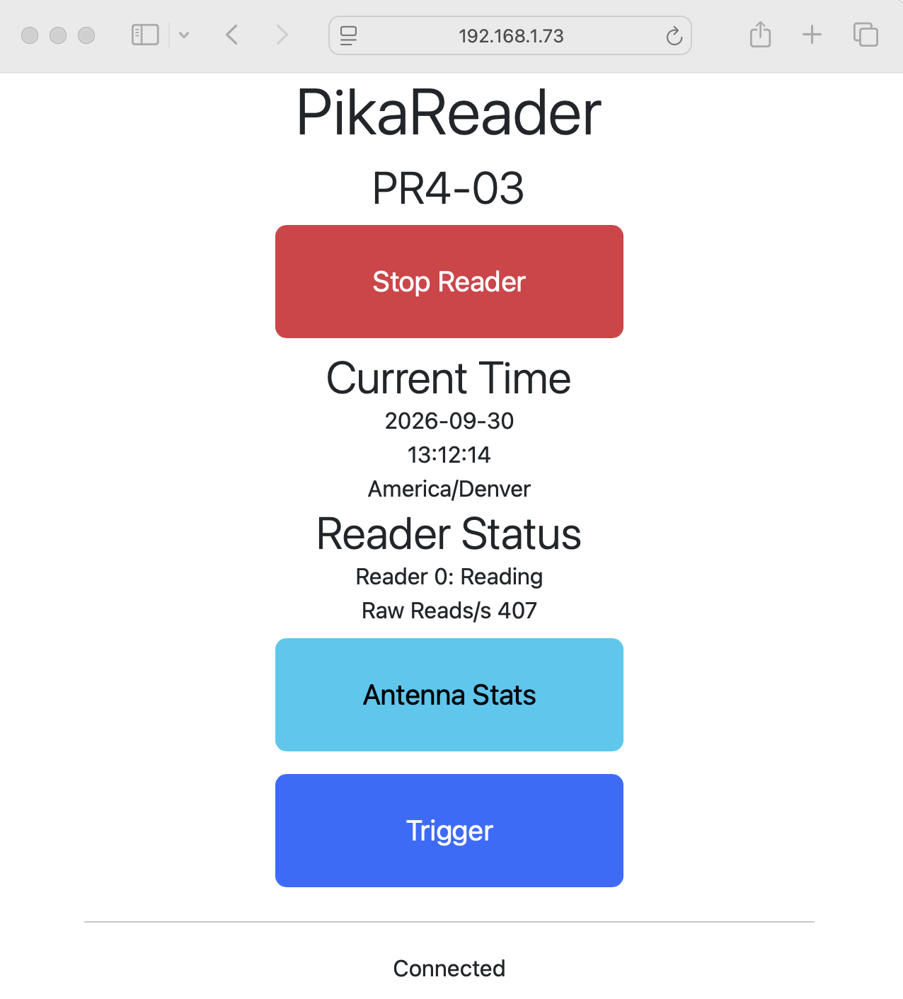
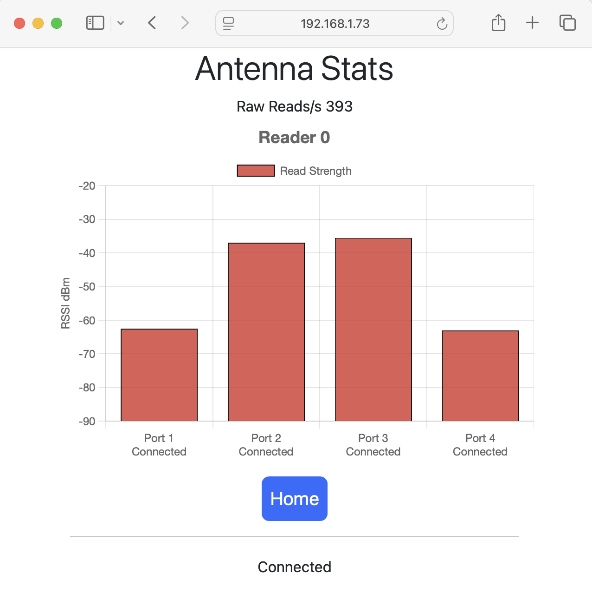

# PikaReader: OpenSource RFID Reader

***

PikaReader is intended to sit on a small single board computer (Raspberry Pi, etc) and connect to a local RFID Readers such as an Impinj R420.
The intent is to eliminate the typical "Single Point of Failure" modes we see when a timing application connects directly to a raw RFID reader.
By pairing a PikaReader instance with each RFID Reader with a dedicated network cable to the RFID Reader, the primary timing laptop can go offline and the timer will not lose any data as a result. 

The system supports a "rewind" function that allows the PikaReader system to collect tag reads that can later be downloaded and imported into a timing application (PikaTimer, RaceDay Scoring, etc). 
This allows for remote and offline readers for on-course splits or remote starting lines. 

## Current Features
* Web based status and control (start/stop reading, trigger).
* Reader profiles (Start Mats, Start Panels, Finish Mats, Finish Panels, Split Side Panels) that set up every reader for the job, switchable from the web UI or the api.
* Support for Impinj Speedway R420 (via the Octane 6.x SDK)
* EXPERIMENTAL support for the R220 and R700/R720 readers (via the Octane 6.x SDK), with optional LLRP over TLS.
* EXPERIMENTAL Support for Zebra / Motorola FX7400, FX7500, FX9500, FX9600 and FXR90 readers (via LLRP).
* Multiple readers (of any supported type) at the same time.
* Ability to store and "rewind" tag reads for later retrieval by the timing application.
* Live streaming of tag reads via a websocket to a timing application or the [PikaDownloader](https://github.com/PikaTimer/PikaDownloader/) app.
* Per-antenna read stats via status api and real time web display.
* Per-profile read filters to reduce the number of tag reads transmitted to the timing application.
* Debug log available via built in http server.
* Antenna Status Display via web UI.
* Support for both Decimal and Hex encoded tags.
* Support for a "trigger" that can be used to drop a special "0" chip read to use to mark the start of a race. 

## Additional Notes
* Use the [PikaDownloader](https://github.com/PikaTimer/PikaDownloader/) app to download data from the reader to a local text file.
* See the [PikaReader4Pi](https://github.com/PikaTimer/PikaReader4Pi) project for an example of building a small standalone reader.

## Planned 
* Integration with PikaTimer application 
* Integration with PikaRelay for remote retrieval of data
* Support for UART based readers (TSL and ThingMagic/Jadak )
* Web Based configuration tool

## Screen Snapshots

*Main Web Interface:*

*Antenna Stats:*

## Usage
Requires OpenJRE 21 or newer. 

Launch the jar file: java -jar PikaReader.jar 

Press Ctrl-C (or send SIGTERM / SIGHUP) to stop. The readers and web server are shut down cleanly.

The default web UI port is http on port 8080. 
You can use the web based UI to start or Stop the reader or create a "trigger" to mark an event such as the start of a race. 

HTTP paths for basic system status and information
- `/` -- Basic System information and web UI for control of PikaReader 
- `/antennaStatus` -- Show the current antenna port stats

REST api paths:
- `/start` -- Start the reader
- `/stop` -- Stop the reader
- `/rewind` -- rewind all of today's data from PikaReader (current day, local time)
- `/rewind/<from>` -- Rewind all data after <from> date/time (reads stored history from disk if <from> is before today). Time in ISO format (YYYY-MM-DDTHH:MM:ss)
- `/rewind/<from>/<to>` -- Rewind data between from and to
- `/debug` -- Dump the debug log to the browser
- `/trigger` -- Record a "trigger" time (chip = 0, reader = 0, antenna = 0) to mark an event
- `/status` -- dump the current reader status
- `/profiles` -- list the reader profiles and the current one
- `/profile` -- the current reader profile and the settings each reader is using for it
- `PUT /profile/<profile>` -- change the reader profile, by id or name (e.g. `curl -X PUT http://<pikareader>:8080/profile/start_mats`). Returns `409` while the readers are reading and `404` for an unknown profile.

Websocket (ws://)
- `/status` -- sends a message once a second with the current reader status
- `/events` -- send a message for each read or status update

## Reader Profiles
A profile optimizes the reader configuration for a particular situation (start, finish, side panels, etc).  Pick one from the Reader Profile list in the web UI (you'll be asked to confirm) or with `PUT /profile/<profile>`. The profile can only be changed while the readers are stopped. The choice is saved in the config file, so it is kept across restarts.

| Profile | Use | Tag Population |
| --- | --- | --- |
| Start Mats (`start_mats`) | Start line mats. Dense waves of runners, walking to jogging. | 32 |
| Start Panels (`start_side_panels`) | Side panels at the start. A deep, packed crowd; catches bibs the mats missed. | 64 |
| Finish Mats (`finish_mats`, the default) | Finish line mats. 1-10 runners at a time; as many reads per tag as possible for a sharp RSSI peak. | 16 |
| Finish Panels (`finish_side_panels`) | Side panels at the finish. A backup to the mats; catches tags shadowed by bodies. | 32 |
| Split Side Panels (`split_side_panels`) | On-course split with side panels only, which must read the full road width. | 16 |

The profile also picks the read filter: how the raw reads of each tag are boiled down to the reads sent to the timing application. Each filter sends the strongest (highest RSSI) read it saw.

| Profile | Reads sent |
| --- | --- |
| Start Mats | The strongest read in each 1 second window, so a runner standing on the mats is reported once a second. |
| Start Panels | The strongest read in each 3 second window, so a crowd in view doesn't flood the timing application. |
| Finish Mats | The strongest read in each 2 second window. Change it with `"Finish Mats Gating"` (seconds) in the `Reader` section. |
| Finish Panels, Split Side Panels | One read per pass, and never more than one every 15 seconds. The tag is watched while its RSSI rises, and its strongest read is sent once the RSSI (the average of the last 3 reads on the antenna that saw it strongest) has stayed 6 dB below its peak for 1 second, or the tag hasn't been seen for 3 seconds, or 15 seconds after its first read (a runner standing next to the panel). The tag's reads for the next 15 seconds are ignored. If it is still in view after that, it is sent again, and so on every 15 seconds. Once it has been out of view for 3 seconds (and 15 seconds have passed since it was sent), its next read starts a new pass. |

A window opens on a tag's first read and closes when its time is up. While the tag stays in view the windows follow back to back, so a tag standing on the mats is sent exactly once per window (60 reads a minute on Start Mats, 30 on Finish Mats, 20 on Start Panels). Once a whole window passes without a read, the tag's next read opens a new window. `Gating Style` sets what counts as one tag: `READER` (default) is the chip on each reader, `BOX` the chip on all readers together, and `ANTENNA` the chip on each reader antenna.

For the gory details (what each profile sets on the Impinj and Zebra readers, how sessions are assigned, the profile settings in the config file and per-reader overrides, plus the setup and config options for each Impinj and Zebra / Motorola FX reader), see [Gory Details](Gory%20Details.md).

## Logging
Debug logs are written to `pikareader.log` in the system temp directory. Use `-DPIKAREADER_LOG=/path/to/file.log` to change the output file name and location.
A new log file is started each time PikaReader runs, and the logs from the last 5 runs are kept (`pikareader.log`, `pikareader.log.1` ... `pikareader.log.4`).

## Notice!
The first time the app is run, it will automatically create a basic config file. 
You will need to quit PikaReader and then edit the ~/.PikaReader.conf file to configure the app. 
Once this is done you can restart the app and being using it. 

